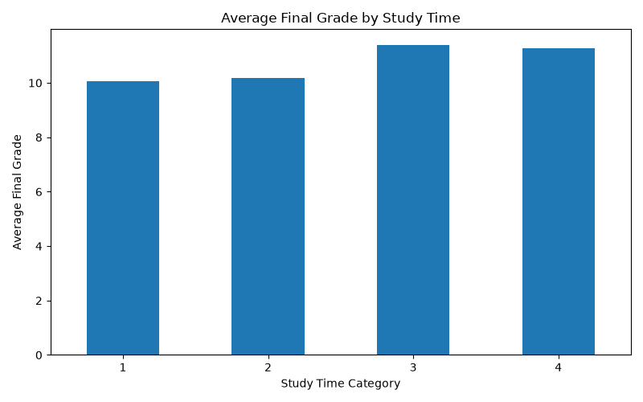
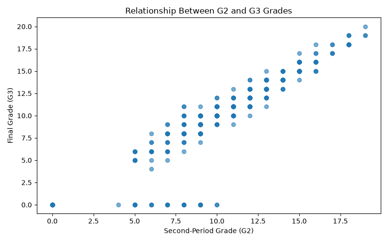
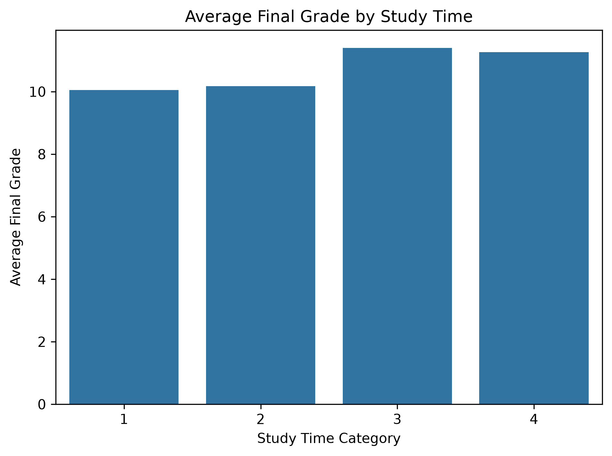
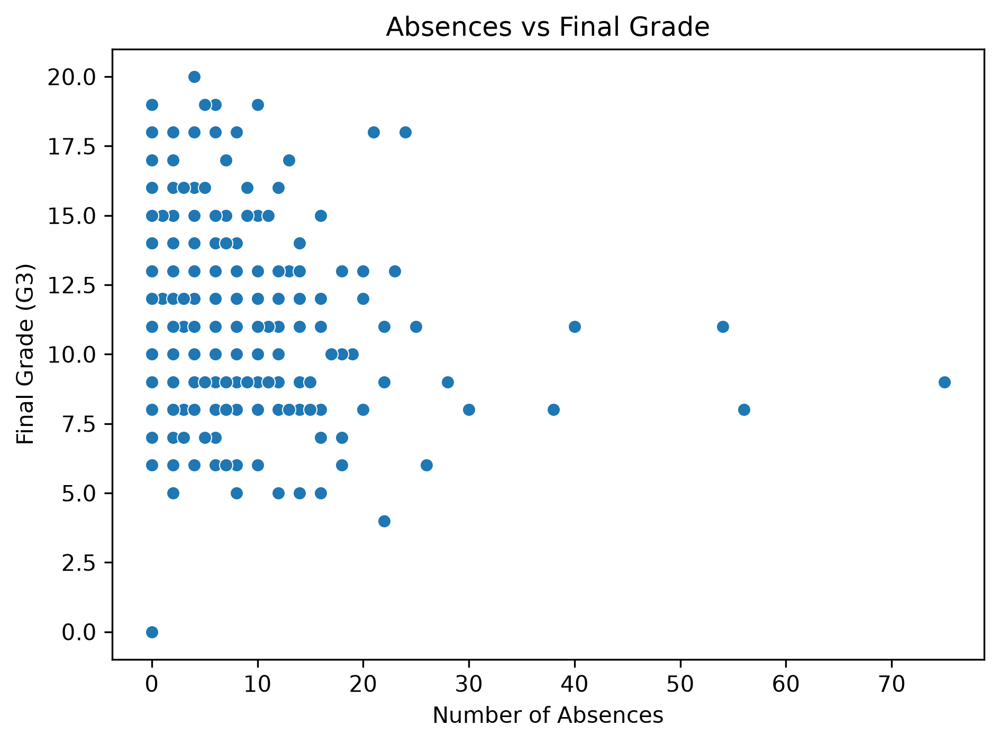
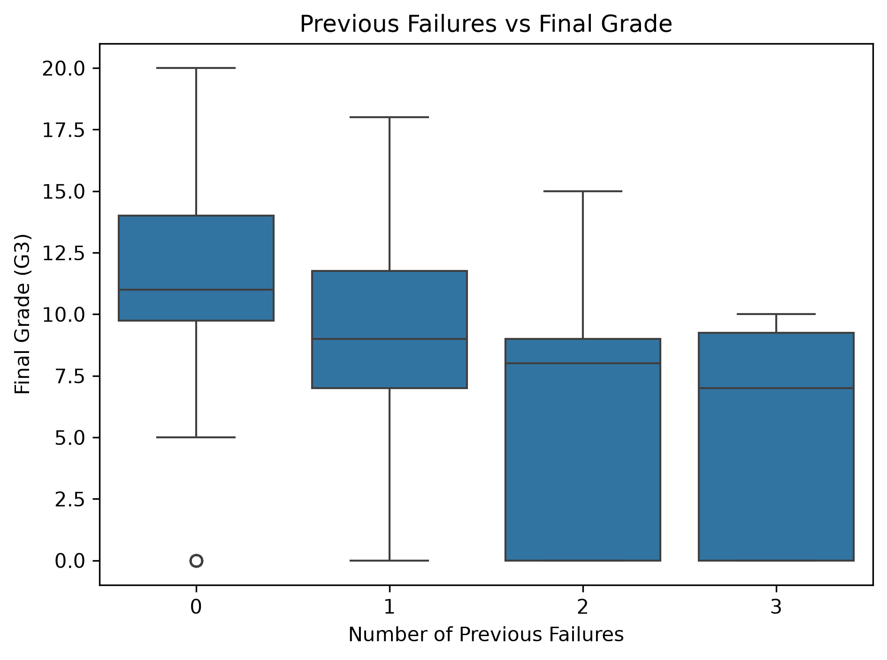

# Student Performance Data Science Project

## About the Project

This project explores student performance using Python, statistical analysis, data visualization, and exploratory data analysis (EDA).

The goal is to investigate patterns in student performance and understand how different factors may relate to academic outcomes.

## Objectives

* Explore and understand the dataset.
* Clean and prepare data for analysis.
* Perform exploratory data analysis (EDA).
* Apply statistical techniques to investigate patterns.
* Visualize findings using charts and graphs.
* Communicate insights through data-driven conclusions.

## Technologies

* Python
* Pandas
* NumPy
* Matplotlib
* Statistics

## Project Status

In Progress 🚧

## Learning Goals

This project is part of my journey into Data Science, where I am developing practical skills in Python, statistics, and data analysis.

## Key Findings

The following insights were obtained from the student performance dataset:

* **Average Final Grade:** 10.42 out of 20.
* **Highest Final Grade:** 20.
* **Lowest Final Grade:** 0.
* **Study Time Analysis:** Students in study-time category 3 had the highest average final grade (11.40), followed by category 4 (11.26).
* **Grade Correlation:** Second-period grades (G2) and final grades (G3) showed a strong positive correlation of **0.905**.

### Visualizations

**1. Study Time vs Final Grade**

This bar chart compares average final grades across study-time categories.

**2. Second-Period Grade vs Final Grade**

This scatter plot illustrates the relationship between second-period grades and final grades.

## Analysis and Findings

This project explores student performance using Python, Pandas, NumPy, Matplotlib, and Seaborn.

### Analyses Performed

* Explored the structure and statistical properties of the student dataset.
* Investigated the relationship between study time and final grades.
* Examined the relationship between second-period grades (G2) and final grades (G3).
* Analyzed student absences and final grades.
* Investigated previous class failures and final grades.
* Compared average grades across study-time categories.

### Key Findings

* **Study Time:** Students in study-time categories 3 and 4 had higher average final grades than students in categories 1 and 2.
* **Previous Grades:** G2 and G3 showed a strong positive correlation of approximately 0.905.
* **Absences:** The correlation between absences and final grades was approximately 0.034, indicating a negligible linear relationship.
* **Previous Failures:** The correlation between previous failures and final grades was approximately -0.360, indicating a negative relationship.

These findings describe patterns in the dataset and do not establish causation.

### Visualizations

The project includes visualizations of:

* Study time vs. final grade
* G2 vs. G3
* Average final grade by study-time category
* Absences vs. final grade
* Previous failures vs. final grade

## Visualizations

### Study Time vs. Final Grade

### G2 vs. G3

### Average Grade by Study Time

### Absences vs. Final Grade

### Previous Failures vs. Final Grade

